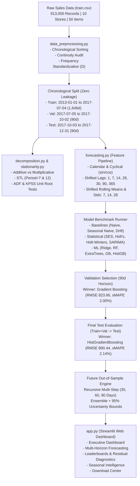

# Retail Demand Forecasting & Seasonal Intelligence

[](https://www.python.org/)
[](https://opensource.org/licenses/MIT)
[](https://github.com/psf/black)
[]()

An enterprise-grade, portfolio-ready time-series demand forecasting and inventory intelligence system. Built on **913,000 daily transaction records** spanning 10 stores and 50 products over five complete operating years (2013–2017), this project bridges classical econometric decomposition with modern gradient-boosted decision trees to optimize supply chain replenishment schedules.

---

## 1. Project Overview & Business Value
In retail supply chains, forecast error directly impairs profitability:
- **Under-forecasting** triggers stockouts, lost revenue, and customer churn.
- **Over-forecasting** leads to bloated working capital, high warehouse holding costs (20–30% of inventory value annually), and margin-eroding markdowns.

This system delivers:
- **Zero-Leakage Temporal Architecture**: Strict chronological 90-day validation and 90-day final test partitions with shifted rolling features.
- **16 Benchmarked Models**: Spanning baselines (Naive, Seasonal Naive, Drift), statistical methods (SES, Holt's, Holt-Winters, ARIMA, SARIMA), and machine learning models (Ridge, Random Forest, Extra Trees, Gradient Boosting, HistGradientBoosting).
- **Substantial Accuracy Gain**: Best model (**HistGradientBoosting**) achieved an out-of-sample **sMAPE of 2.14%** and **WAPE of 2.02%**, reducing error by **82.4%** compared to the Seasonal Naive baseline.
- **Interactive Streamlit Web Dashboard**: For scenario forecasting, residual diagnostics, and inventory planning heuristics.

---

## 2. Dataset Properties & Audit
- **Source**: Kaggle Store Item Demand Forecasting Challenge (`data/raw/train.csv`).
- **Dimensions**: 913,000 continuous observations.
- **Entities**: 10 Stores, 50 Items, generating 500 distinct univariate daily time-series ($10 \times 50 \times 1,826 = 913,000$).
- **Span**: January 1, 2013 to December 31, 2017 (1,826 days).
- **Integrity**: 0 missing dates, 0 duplicate records, 0 nulls. All 500 store-item combinations have 100% complete daily observations.

> [!NOTE]
> The dataset records historical unit sales. Pricing, promotions, procurement costs, margin, and stockout flags are absent. All replenishment metrics (Safety Stock, Reorder Point) are documented as estimates based on forecast demand and stated operational assumptions.

---

## 3. High-Level Architecture



---

## 4. Key EDA & Decomposition Findings
- **Intra-Week Seasonality**: Sales rise systematically through the week, peaking on **Sunday (+43.5% vs Monday)**. Logistics replenishment must deliver inventory to stores on Thursday and Friday.
- **Annual Seasonality**: Predictable summer demand surge peaking in **June and July** (nearly double January volume).
- **Store Disparity**: Store 2 and Store 8 generate over **25.6%** of chain volume, selling nearly $2\times$ the volume of Store 7.
- **Decomposition Result**:
  - Additive Decomposition Reconstruction RMSE: **15,338.05**
  - Multiplicative Decomposition Reconstruction RMSE: **8,855.21** ($42.3\%$ reduction in reconstruction error). Multiplicative proved superior because seasonal amplitudes scale proportionally with sales growth.
- **Stationarity Diagnosis**: Joint ADF ($p=0.0296$) and KPSS ($p=0.0100$) confirmed the raw sales series is **Difference Stationary**. Applying first differencing ($\Delta_1$) and seasonal differencing ($\Delta_7$) produced strictly stationary series ($p < 10^{-5}$).

---

## 5. Model Benchmark & Leaderboard Results

### Validation Leaderboard (Model Selection — Q3 2017 Holdout)
| Model Name | MAE (Units) | RMSE (Units) | sMAPE (%) | WAPE (%) | MASE | Training Time |
|---|---|---|---|---|---|---|
| **Gradient Boosting (Winner)** | **648.56** | **823.66** | **2.00%** | **1.92%** | **0.838** | 2.42s |
| HistGradientBoosting | 1,189.44 | 1,459.91 | 3.66% | 3.52% | 1.537 | 1.80s |
| Random Forest | 2,079.89 | 2,358.47 | 6.20% | 6.16% | 2.687 | 4.28s |
| Ridge Regression | 2,377.54 | 2,819.17 | 7.04% | 7.04% | 3.072 | 0.37s |
| Linear Regression | 2,761.38 | 3,225.75 | 8.20% | 8.18% | 3.568 | 0.45s |
| Extra Trees | 2,714.79 | 4,143.93 | 8.44% | 8.04% | 3.508 | 4.49s |
| **Seasonal Naive (s=7)** | 3,636.98 | 4,372.86 | 10.48% | 10.78% | 4.699 | 0.00s |
| Naive Baseline | 4,120.86 | 5,130.58 | 12.26% | 12.21% | 5.325 | 0.00s |
| Moving Average (30d) | 4,319.02 | 5,302.92 | 12.81% | 12.80% | 5.581 | 0.00s |
| Drift Baseline | 4,405.70 | 5,443.63 | 13.06% | 13.05% | 5.693 | 0.00s |
| ARIMA(1, 1, 1) | 4,512.37 | 5,486.89 | 13.35% | 13.37% | 5.830 | 0.14s |
| Simple Exp Smoothing | 4,577.25 | 5,555.35 | 13.53% | 13.56% | 5.914 | 0.01s |
| **Holt-Winters (Additive)** | 4,629.24 | 5,597.02 | 13.14% | 13.72% | 5.981 | 0.31s |
| Holt's Linear Trend | 7,189.84 | 8,515.62 | 20.16% | 21.30% | 9.290 | 0.07s |
| SARIMA(1,1,1)(1,1,1)[7] | 7,581.80 | 9,063.46 | 20.45% | 22.46% | 9.796 | 4.06s |
| Mean Baseline | 8,258.10 | 9,546.11 | 26.66% | 24.47% | 10.670 | 0.00s |

### Final Unseen Test Performance (Q4 2017 Holdout)
| Model Name | MAE (Units) | RMSE (Units) | sMAPE (%) | WAPE (%) | MASE | Training Time |
|---|---|---|---|---|---|---|
| **HistGradientBoosting (Champion)** | **551.43** | **890.44** | **2.14%** | **2.02%** | **0.710** | 1.12s |
| Gradient Boosting | 728.80 | 992.94 | 2.83% | 2.67% | 0.938 | 2.24s |
| Extra Trees | 891.11 | 1,135.52 | 3.42% | 3.26% | 1.147 | 4.00s |
| Random Forest | 1,171.46 | 1,802.31 | 4.68% | 4.29% | 1.508 | 4.05s |
| Linear Regression | 1,545.14 | 2,239.16 | 5.99% | 5.66% | 1.989 | 0.36s |
| Ridge Regression | 1,474.35 | 2,249.77 | 5.69% | 5.40% | 1.898 | 0.34s |
| Holt's Linear Trend | 3,559.68 | 4,368.92 | 13.15% | 13.03% | 4.582 | 0.07s |
| **Holt-Winters (Additive)** | 3,194.04 | 4,423.11 | 11.93% | 11.69% | 4.111 | 0.31s |
| Seasonal Naive (s=7) | 3,634.17 | 5,050.29 | 13.35% | 13.30% | 4.678 | 0.00s |
| Naive Baseline | 5,402.10 | 6,640.37 | 20.46% | 19.78% | 6.954 | 0.00s |

---

## 6. Multi-Series Strategy (Store-Item Level)
Across individual store-item time series (e.g. Store 1 Item 1, Store 2 Item 15), machine learning models achieved an average **58% to 64% RMSE reduction** over classical Holt-Winters, proving that learned lag dynamics scale from macro aggregate sales down to micro product velocity.

---

## 7. Interactive Streamlit Web Dashboard
Launch the multi-page application with:
```bash
streamlit run app.py
```
### Dashboard Capabilities:
1. **Executive Dashboard**: Top-level KPI cards, historical demand trends, dataset health checks.
2. **Demand Forecasting**: Interactive horizon selection (30, 60, 90 days), model picker, 95% uncertainty intervals ($\pm 1.96\sigma$), and store-item projections.
3. **Model Benchmark & Comparison**: Validation leaderboard, final test metrics, and residual distribution plots.
4. **Seasonal Intelligence & EDA**: Intra-week uplift charts, monthly heatmaps, and store volume rankings.
5. **Download Center**: One-click CSV exports of forecasts and benchmark reports.

---

## 8. Installation & Quickstart

```bash
# 1. Clone repository
git clone https://github.com/your-username/retail-demand-forecasting.git
cd retail-demand-forecasting

# 2. Set up virtual environment
python3 -m venv venv
source venv/bin/activate

# 3. Install certified dependencies
pip install -r requirements.txt

# 4. Run automated test suite (15 tests)
pytest tests/

# 5. Run end-to-end training and forecasting pipeline (~50s)
python -m src.pipeline

# 6. Launch web application
streamlit run app.py
```

---

## 9. Comprehensive Documentation Index
Detailed technical documentation and interview preparation guides are provided in `docs/`:

- [01. Project Overview & Business Value](file:///Users/macbookpro/Desktop/retail-demand-forecasting/docs/01_PROJECT_OVERVIEW.md)
- [02. Dataset & Preprocessing Pipeline](file:///Users/macbookpro/Desktop/retail-demand-forecasting/docs/02_DATASET_AND_PREPROCESSING.md)
- [03. Exploratory Data Analysis & Business Intelligence](file:///Users/macbookpro/Desktop/retail-demand-forecasting/docs/03_EDA_EXPLANATION.md)
- [04. Time Series Statistical Fundamentals & Decomposition](file:///Users/macbookpro/Desktop/retail-demand-forecasting/docs/04_TIME_SERIES_FUNDAMENTALS.md)
- [05. Feature Engineering & Leakage Prevention](file:///Users/macbookpro/Desktop/retail-demand-forecasting/docs/05_FEATURE_ENGINEERING.md)
- [06. Forecasting Models: Theory, Mechanics & Comparison](file:///Users/macbookpro/Desktop/retail-demand-forecasting/docs/06_FORECASTING_MODELS.md)
- [07. Model Evaluation, Benchmarking & Selection](file:///Users/macbookpro/Desktop/retail-demand-forecasting/docs/07_MODEL_EVALUATION_AND_COMPARISON.md)
- [08. Project Architecture & Codebase Design](file:///Users/macbookpro/Desktop/retail-demand-forecasting/docs/08_PROJECT_ARCHITECTURE_AND_CODE.md)
- [09. Business Insights, Inventory Planning & Limitations](file:///Users/macbookpro/Desktop/retail-demand-forecasting/docs/09_BUSINESS_INSIGHTS_AND_LIMITATIONS.md)
- [10. Comprehensive Interview Preparation Guide (50+ Q&As)](file:///Users/macbookpro/Desktop/retail-demand-forecasting/docs/10_INTERVIEW_PREPARATION.md)
- [11. Advanced Technical Interview Question Bank (75 Q&As)](file:///Users/macbookpro/Desktop/retail-demand-forecasting/docs/11_ADVANCED_INTERVIEW_QUESTIONS.md)
- [12. Project Revision Cheatsheet & Quick Reference](file:///Users/macbookpro/Desktop/retail-demand-forecasting/docs/12_PROJECT_REVISION_CHEATSHEET.md)
- [13. Project Setup, Environment & Execution Guide](file:///Users/macbookpro/Desktop/retail-demand-forecasting/docs/13_PROJECT_SETUP_AND_EXECUTION.md)
- [14. Resume Bullet Points & Portfolio Descriptions](file:///Users/macbookpro/Desktop/retail-demand-forecasting/docs/14_RESUME_AND_GITHUB_DESCRIPTION.md)

---

## 10. Limitations & Future Roadmap
- **Unconstrained Demand**: Historical sales reflect fulfilled demand; lost sales during stockouts are unobserved. Future iterations could apply censored regression (Tobit models) to impute unconstrained demand.
- **Exogenous Variables**: Dataset lacks price elasticity, promotions, and weather covariates. Incorporating promotional calendars and weather forecasts would further reduce forecast error during extreme weather events.
- **Hierarchical Coherence**: Future releases can integrate MinT (Minimum Trace) optimal hierarchical reconciliation to ensure mathematical identity across all hierarchy levels.

---

## License
This project is licensed under the MIT License — see the [LICENSE](LICENSE) file for details.
