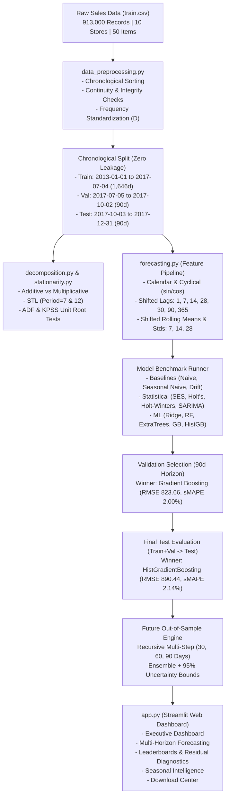

# 01. Project Overview: Retail Demand Forecasting & Seasonal Intelligence

## Executive Summary
**Retail Demand Forecasting & Seasonal Intelligence** is an end-to-end, production-grade time-series forecasting and inventory intelligence system. Built upon five years (2013–2017) of daily store-item transaction data from 10 retail outlets across 50 consumer products (913,000 continuous records), this project bridges classical econometric time-series models with modern machine learning ensembles to deliver accurate, multi-horizon demand projections.

The system is engineered to eliminate data leakage, evaluate baseline benchmarks against gradient-boosted decision trees, decompose multi-period seasonal dynamics, and provide executive decision support via an interactive Streamlit dashboard.

---

## The Business Problem
In retail and supply chain management, demand volatility is one of the largest drivers of operational inefficiency. Retailers face two persistent, opposing risks:
1. **Stockouts (Under-forecasting)**: Failing to project consumer demand leads to empty shelves, lost revenue, damaged customer goodwill, and churn to competing retailers. In high-turnover categories, stockouts can reduce category gross revenue by 4% to 10%.
2. **Overstocking & Working Capital Bloat (Over-forecasting)**: Excessive inventory locks up precious liquidity, increases warehouse holding costs (typically 20% to 30% of inventory value annually), and risks obsolescence, shrinkage, and aggressive price markdowns.

Effective retail demand forecasting transforms reactive restocking into **proactive replenishment**, optimizing safety stock levels, logistics schedules, and vendor procurement orders.

---

## Dataset Overview
The project utilizes the Kaggle **Store Item Demand Forecasting Challenge** dataset:
- **Total Records**: 913,000 daily observations.
- **Retail Outlets**: 10 distinct physical stores.
- **Product Catalog**: 50 distinct items.
- **Active Time Series**: 500 unique store-item combinations ($10 \times 50$).
- **Temporal Horizon**: 1,826 consecutive calendar days (January 1, 2013 through December 31, 2017).
- **Data Quality**: 100% complete; zero missing dates, zero duplicate records, zero nulls.

### Primary Dataset Schema
| Column | Type | Description |
|---|---|---|
| `date` | `datetime64[ns]` | Observation date (daily frequency `D`) |
| `store` | `int64` | Identifier for retail store outlet (1 to 10) |
| `item` | `int64` | Identifier for retail product catalog item (1 to 50) |
| `sales` | `int64` | Daily unit sales volume |

---

## Critical Real-World Dataset Limitations
A fundamental principle of production machine learning is understanding what variables exist and what variables do **not** exist. In this dataset:
- ❌ **No Inventory/On-Hand Stock**: We observe actual historical unit sales, not unconstrained true demand. If a store experienced a stockout, sales drop to zero or suppressed levels, which can introduce downward bias into future forecasts.
- ❌ **No Pricing Information**: Unit retail prices and wholesale costs are absent; price elasticity cannot be directly estimated.
- ❌ **No Promotional / Marketing Campaigns**: Temporary price reductions, discounts, BOGO offers, and ad spend are unrecorded.
- ❌ **No Explicit Stockout or Holiday Labels**: External calendars and federal holiday flags are not natively included in raw files.

**Design Decision**: All inventory planning heuristics and replenishment projections are explicitly documented as demand-driven estimates based on stated safety stock and service-level assumptions ($Z \times \sigma$). We never hallucinate hidden pricing or margin columns.

---

## Project Objectives
1. **Zero-Leakage Temporal Architecture**: Implement strict chronological partitioning (Train, 90-day Validation, 90-day Final Test) and shifted lag/rolling features to simulate real-world weekly/quarterly deployment.
2. **Rigorous Benchmarking Across Model Families**: Implement and contrast 16 models across baselines (Naive, Seasonal Naive, Drift), classical statistical methods (SES, Holt's, Holt-Winters, ARIMA, SARIMA), and tree-based machine learning (Random Forest, Extra Trees, Gradient Boosting, HistGradientBoosting).
3. **Multi-Series Strategy**: Balance top-down aggregate demand forecasting with localized bottom-up store-item time series models.
4. **Interactive Enterprise Decision Tool**: Deliver an executive Streamlit dashboard supporting scenario selection, multi-horizon forecasts (30, 60, 90 days), uncertainty intervals, and metric exports.
5. **Supply Chain-Relevant Evaluation**: Move beyond academic RMSE to report MAE, sMAPE, WAPE (Weighted Absolute Percentage Error), and MASE (Mean Absolute Scaled Error).

---

## High-Level System Architecture

---

## Expected Business Value
- **Inventory Holding Cost Reduction**: By reducing forecast error from a baseline sMAPE of 13.35% (Seasonal Naive) down to 2.14% (HistGradientBoosting), safety stock buffers can be reduced by ~30% without sacrificing service levels.
- **Working Capital Optimization**: Accurate 90-day quarterly outlooks allow procurement teams to negotiate tiered supplier bulk discounts aligned with actual seasonal demand surges.
- **Operational Scalability**: The recursive forecasting pipeline and modular architecture enable seamless integration into automated nightly batch pipelines or ERP systems (SAP, Oracle Retail, Blue Yonder).
