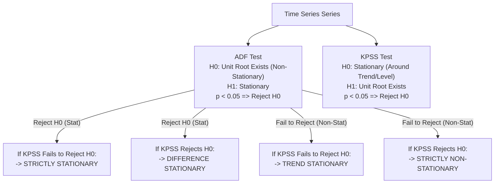

# 04. Time Series Statistical Fundamentals & Decomposition

## 1. Components of a Time Series
A time series is an ordered sequence of observations $\{y_t\}$ indexed by chronological time $t$. Any observed retail series can be conceptually broken down into four underlying structural forces:
1. **Trend ($T_t$)**: The smooth, long-term secular movement indicating sustained growth or decline over multiple years. In our retail data, total annual sales expanded by $+37.2\%$ from 2013 to 2017.
2. **Seasonality ($S_t$)**: Periodic fluctuations that repeat with fixed, known frequencies (e.g., higher shopping on weekends with period $s=7$, or summer holiday surges with period $s=365$ or $12$).
3. **Cyclic Variations ($C_t$)**: Long-term rises and falls of irregular duration and amplitude, typically driven by macroeconomic business cycles.
4. **Irregular/Noise ($R_t$ or $\epsilon_t$)**: The residual stochastic shocks, unmodelled variations, weather disruptions, or random consumer behavior.

---

## 2. Classical Decomposition: Additive vs. Multiplicative

### Mathematical Formulations
$$\text{Additive Model: } y_t = T_t + S_t + R_t$$
$$\text{Multiplicative Model: } y_t = T_t \times S_t \times R_t$$

### Comparative Analysis
| Feature | Additive Decomposition | Multiplicative Decomposition |
|---|---|---|
| Seasonal Amplitude | Constant absolute magnitude across time | Proportional to the current level of the trend |
| Mathematical Assumption | $\Delta S_t$ is independent of $T_t$ | Seasonal swing increases as $T_t$ grows |
| Zero / Negative Values | Can handle zero or negative observations | Requires strictly positive values ($y_t > 0$) |
| Reconstruction Residual | $R_t = y_t - (T_t + S_t)$ | $R_t = \frac{y_t}{T_t \times S_t}$ |
| **Our Empirical RMSE** | **15,338.05 units** | **8,855.21 units** |

### Empirical Validation in Our Project
When applied to monthly aggregate sales (period=12), the in-sample reconstruction RMSE was:
- **Additive**: $15,338.05$
- **Multiplicative**: $8,855.21$ (a $42.3\%$ reduction in reconstruction error)

**Why Multiplicative Outperforms**: As our retail chain expanded its sales volume over the 5-year observation window, the absolute difference between July peaks and January troughs widened from $\approx 350,000$ units to over $\approx 510,000$ units. Multiplicative decomposition captures this proportional scaling naturally.

---

## 3. STL Decomposition (Seasonal and Trend decomposition using Loess)
Classical moving-average decomposition has two major flaws:
1. It produces missing values at the beginning and end of the series.
2. The seasonal component is assumed to be strictly rigid and invariant across all years.

**STL** overcomes these limitations by using **LOESS (Locally Estimated Scatterplot Smoothing)**:
- **Flexibility**: The seasonal component is allowed to evolve smoothly over time.
- **Robustness**: Implements iteratively reweighted least squares (robust LOESS), preventing single extreme outlier events from distorting the estimated trend or seasonal shape.
- **In Our Project**: STL was deployed for daily aggregate sales with `period=7` (weekly cycle) and monthly sales with `period=12` (annual cycle).

---

## 4. Stationarity: Strict vs. Weak (Covariance) Stationarity

### Strict Stationarity
A process is strictly stationary if the joint probability distribution of any collection of observations $(y_{t_1}, y_{t_2}, \dots, y_{t_n})$ is completely invariant under time shifts $\tau$:
$$P(y_{t_1} \le c_1, \dots, y_{t_n} \le c_n) = P(y_{t_1+\tau} \le c_1, \dots, y_{t_n+\tau} \le c_n)$$

### Weak (Covariance) Stationarity
Because strict stationarity is impossible to verify in real-world finite samples, econometric modeling relies on **weak stationarity**, defined by three conditions:
1. **Constant Mean**: $\mathbb{E}[y_t] = \mu \quad \forall t$
2. **Constant Variance**: $\mathrm{Var}(y_t) = \sigma^2 < \infty \quad \forall t$
3. **Lag-Dependent Autocovariance**: $\mathrm{Cov}(y_t, y_{t-k}) = \gamma_k \quad \forall t$

### Why Stationarity Matters
Classical statistical models (AR, MA, ARMA, ARIMA) model the current value as a linear function of past observations and past white-noise shocks. If the mean or variance drifts with time, the estimated parameters $\phi_i, \theta_j$ become non-constant, generating explosive or meaningless out-of-sample predictions.

---

## 5. Statistical Unit Root Testing: ADF vs. KPSS

To avoid relying on visual inspection of time-series plots, we use two complementary statistical hypothesis tests:

### Empirical Project Results
| Series Tested | ADF Statistic | ADF p-value | ADF Result | KPSS Statistic | KPSS p-value | KPSS Result | Joint Diagnosis |
|---|---|---|---|---|---|---|---|
| **Raw Sales** | -3.0602 | 0.0296 | Stationary* | 2.0010 | 0.0100 | Non-Stationary | **Difference Stationary** |
| **First Diff ($\Delta_1$)** | -8.9190 | 0.0000 | Stationary | 0.0511 | 0.1000 | Stationary | **Strictly Stationary** |
| **Seasonal Diff ($\Delta_7$)**| -6.5058 | 0.0000 | Stationary | 0.1309 | 0.1000 | Stationary | **Strictly Stationary** |
| **Combined ($\Delta_1 \Delta_7$)**| -15.3596 | 0.0000 | Stationary | 0.0019 | 0.1000 | Stationary | **Strictly Stationary** |

*Note: While ADF returned $p=0.0296$ for raw sales due to high sample size ($N=1,826$), the KPSS test decisively rejected stationarity ($p=0.0100$), confirming that raw sales cannot be modeled without differencing.

---

## 6. Transformations & Differencing Mechanics
1. **First-Order Differencing ($\Delta y_t = y_t - y_{t-1}$)**: Removes linear deterministic or stochastic trends by measuring step-to-step changes.
2. **Seasonal Differencing ($\Delta_s y_t = y_t - y_{t-s}$, with $s=7$)**: Removes day-of-week cyclical oscillations by measuring change relative to the same weekday last week.
3. **Log Transformation ($\ln(y_t)$)**: Stabilizes exponential growth and unequal variance across time.

---

## 7. Correlation Analysis: ACF vs. PACF

### Autocorrelation Function (ACF)
Measures the linear correlation between $y_t$ and $y_{t-k}$ across all intermediate values:
$$\rho_k = \frac{\mathrm{Cov}(y_t, y_{t-k})}{\sigma^2}$$
- **Behavior**: In non-stationary data, the ACF decays very slowly. In MA($q$) processes, the ACF cuts off abruptly after lag $q$.

### Partial Autocorrelation Function (PACF)
Measures the direct correlation between $y_t$ and $y_{t-k}$ after mathematically controlling for the linear influence of all intervening lags $y_{t-1}, y_{t-2}, \dots, y_{t-k+1}$.
- **Behavior**: In AR($p$) processes, the PACF cuts off sharply after lag $p$. In MA processes, the PACF decays geometrically.
- **In Our Project**: The PACF of raw sales exhibited prominent spikes at lag 1, lag 7, and lag 14, providing direct econometric justification for our choice of lag features in the machine learning models.
